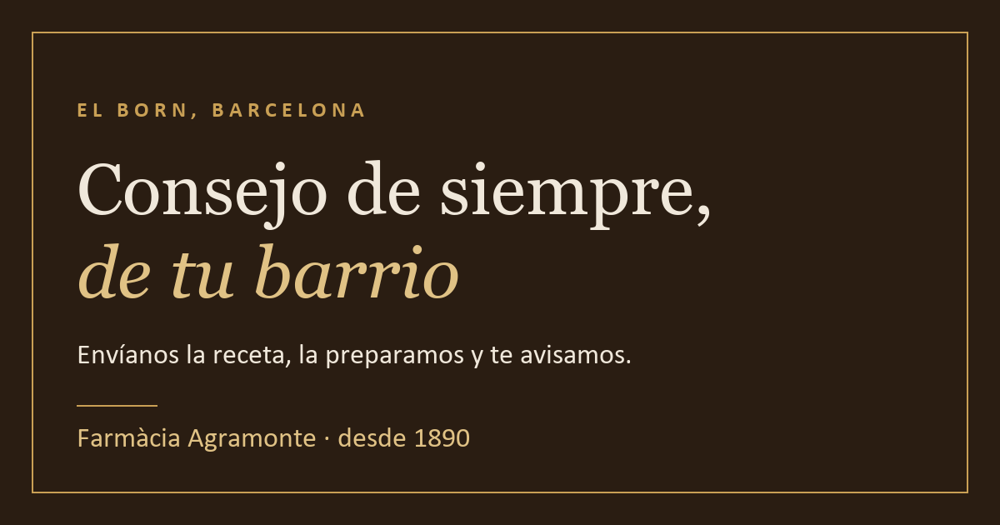

# Farmàcia Agramonte

Web de una farmacia de barrio real, en la Plaça de la Llana (El Born,
Barcelona). Enseña lo que hay en el mostrador, deja apuntar un encargo y lo
manda por WhatsApp. Son ficheros estáticos publicados desde este repositorio,
sin servidor ni base de datos.

`HTML` · `CSS` · `JavaScript` · `Python 3` · `GitHub Pages`

Web: <https://maragramonte.github.io/Farmacia-Agramonte/>

*English summary: [`README.en.md`](README.en.md).*



---

## Qué necesita una farmacia de barrio

Que quien pasa por delante sepa qué hay dentro. Que quien busca «farmacia El
Born» en el móvil encuentre el horario y el teléfono. Y que quien ya sabe lo
que quiere pueda pedirlo sin llamar en mitad del turno.

La web anterior era un WordPress con Divi: hosting, plantilla y mantenimiento
que se pagan cada mes, y una web que con los años nadie sabe actualizar.

Por eso no es una tienda. Hay cesta, pero no pasarela de pago: el encargo sale
por WhatsApp y se paga en el mostrador. Así la web queda fuera del régimen de
venta a distancia, no trata datos personales y se publica gratis en GitHub
Pages.

---

## Verla

[La web está publicada](https://maragramonte.github.io/Farmacia-Agramonte/) y cada
`git push` a `main` la vuelve a publicar en un par de minutos.

Está en **español, catalán e inglés** (el español en la raíz, el catalán en
[`/ca/`](https://maragramonte.github.io/Farmacia-Agramonte/ca/) y el inglés en
[`/en/`](https://maragramonte.github.io/Farmacia-Agramonte/en/)) con un
selector en la cabecera que lleva de cada página a su traducción. El inglés
está porque la Plaça de la Llana es de las zonas con más turismo de Barcelona.

**Para verlo en un minuto:** entra en una categoría, pulsa «Añadir» en un par
de productos y abre la cesta. El mensaje de WhatsApp se escribe solo, con la
lista entera; enviarlo o no es cosa de quien lo lee.

---

## Qué hace

- **Portada** con el horario, la dirección, el teléfono y el botón de WhatsApp
  siempre a la vista, más las novedades, los servicios de mostrador y los tres
  últimos artículos del blog de la farmacia.
- **Catálogo de diez categorías** que no se solapan, con **35 productos
  reales** y una ficha por producto: formato, resumen y los epígrafes de
  consejo cuando los tenga.
- **Cesta sin pago**: se apunta lo que se quiera, se cambian las cantidades y
  el encargo se manda por WhatsApp. No hay pasarela, ni cuentas, ni datos
  personales en ninguna parte.
- **Trilingüe de verdad**, no un traductor encima: 154 páginas con su
  `canonical`, sus `hreflang` y su sitemap.
- **Ficha de Google** montada desde el JSON-LD `Pharmacy` de la portada:
  dirección, teléfono y los dos tramos de horario.
- **Las tres páginas legales**, con los datos del titular que exige la LSSI.

**Medicamentos es la única categoría vacía, y lo es a propósito**: enseñarlos
en un catálogo es publicidad de medicamentos, que la ley prohíbe al público
para los de receta. Su página explica en su lugar cómo se encarga una receta.

---

## Cómo está construida

Una web **estática**: HTML y CSS, sin dependencias, sin proceso de compilación
y sin servidor de aplicación. No hay `npm`, ni `node_modules`, ni nada que
compilar; para trabajar en ella bastan un editor de texto y Python.

Pero casi nada se escribe a mano. **143 de las 154 páginas las escribe un
generador** a partir de dos JSON:

```
catalogo-datos.json  ─┐
                      ├─→  [ catalogo.py ]  ─→  154 páginas en 3 idiomas
textos.json          ─┘          │               + sitemap.xml
                                 │
index.html (a mano)  ────────────┘  (de aquí salen ca/index.html y en/index.html)
```

Lo único que se ejecuta en el navegador de quien la visita es `cesta.js`: 566
líneas sin dependencias. No hay analítica, no hay cookies y no se pide nada a
ningún tercero: ni siquiera las tipografías, que viajan en el repositorio.

**→ [docs/ESTRUCTURA.md](docs/ESTRUCTURA.md)**: qué hay en cada fichero, qué
se genera y qué se edita.

---

## Decisiones técnicas

**El sitio se genera, y el generador para en vez de escribir algo mal.** La
tira de categorías que va arriba las lista todas, así que añadir una obligaba
a tocar diez ficheros a mano: una errata esperando a ocurrir. Ahora hay una
sola fuente de verdad y el script se niega a continuar si dos productos dan la
misma URL, si falta un icono, si los cajones de la portada no cuadran con el
JSON o si una portada traducida se ha quedado vieja. Lo que no puede
comprobar, lo cuenta al terminar: fotos que faltan, textos sin traducir y
páginas huérfanas, con el `git rm` ya escrito.
[→](docs/CATALOGO.md#el-generador)

**El español se queda en la raíz y los idiomas se añaden encima.** Mover el
español a `/es/` habría roto todas las URL ya indexadas, a cambio de nada.
Añadir el inglés no cambió ni una URL existente, y la URL de un producto no se
traduce porque los nombres son marcas. Las traducciones que falten salen en
español en lugar de dejar un hueco, y el generador dice cuántas son.
[→](docs/IDIOMAS.md)

**La cesta vive en el navegador, y no cobrar es una decisión legal además de
técnica.** El `localStorage` de quien mira la web: nada que administrar, nada
que respaldar, ningún dato de nadie. El botón de añadir nace con `hidden` y lo
destapa el JavaScript, así que si `cesta.js` no carga lo que queda es el
enlace de WhatsApp, que funciona siempre. Y como aquí no se paga, la web sigue
fuera del régimen de venta a distancia y el aviso legal de hoy sigue siendo
cierto.
[→](docs/CESTA.md)

**Ni una petición externa.** Playfair Display y Karla se sirven desde
`tipografias/`, no desde Google Fonts: son OFL, son variables y pesan 82 KB en
total en lugar de los 144 KB que ocuparían sueltas. Sin terceros no hay
transferencia de datos por el mero hecho de visitar la página, y por eso la
política de cookies puede decir la verdad más corta posible: no hay.
[→](docs/DISENO.md#la-web-no-pide-nada-a-nadie)

---

## El estado real

Lo que está hecho y lo que no, sin adornos.

**Hecho.** Las 154 páginas están publicadas e indexables, las diez categorías
tienen página propia, los 35 productos son reales y llevan su URL fijada, los
74 textos de interfaz están traducidos a los tres idiomas, los datos del
titular están completos y la cesta funciona entera, incluido el aviso de
recorte cuando la lista no cabe en un enlace de WhatsApp.

**No hecho.**

- **`fotos/` está vacía**: las 35 fichas enseñan el recuadro de «Foto
  pendiente». El mecanismo está montado: basta dejar el fichero con el nombre
  de la página.
- **Ningún producto trae los epígrafes de consejo** (para qué es, modo de
  empleo, composición, advertencias). Son opcionales a propósito: en una
  farmacia eso lo firma la casa, y una ficha corta es mejor que un epígrafe
  rellenado a ojo.
- **A cuatro productos les falta el formato**, y salen con la marca amarilla.
- **Las legales en catalán e inglés están traducidas pero sin revisar**, y lo
  dicen arriba: la española es la que prevalece.
- **La fecha de fundación se contradice**: la portada dice 1890 en seis
  sitios y la cronología de «Quiénes somos» va de 1600 a 2019. Falta decidir
  cuál es la buena.

---

## Puesta en marcha

Sólo hace falta **Python 3**. No hay dependencias que instalar.

```
python servir.py                   # ver la web en http://localhost:8000
python herramientas/catalogo.py    # regenerar las 143 páginas y el sitemap
python herramientas/acentos.py     # avisos de ortografía español/catalán
```

En Windows, doble clic en `servir.bat` hace lo primero. El servidor imprime
también la IP de este equipo en la red local, que sirve para abrir la web en
el móvil estando en la misma wifi.

Para publicar un cambio no hay más paso que subirlo: **cada `git push` a
`main` republica la web sola**.

**→ [docs/PUBLICAR.md](docs/PUBLICAR.md)**: cómo quedó montado Pages, qué
tocar si se renombra el repositorio y qué haría falta para un dominio propio.

---

## Estructura del repositorio

```
.
├── index.html            La portada española. Se edita ESTA: la catalana y
│                         la inglesa se generan de ella
├── catalogo-*.html       Las diez categorías y las 35 fichas. SE GENERAN
├── historia.html         Quiénes somos. SE GENERA
├── cesta.html            La cesta. SE GENERA
├── aviso-legal.html · privacidad.html · cookies.html · 404.html   A mano
├── ca/ · en/             Todo lo anterior otra vez. Sólo las legales a mano
├── *.css                 marca · portada · catalogo · cesta · legal · idiomas
├── cesta.js              Lo único que se ejecuta al visitar la web
├── herramientas/
│   ├── catalogo.py            El generador
│   ├── catalogo-datos.json    Los productos. Se edita ESTE
│   ├── textos.json            Todos los textos de interfaz, en cada idioma
│   ├── importar.py            Vuelca un export del programa de gestión
│   ├── acentos.py             Ortografía que se confunde entre es y ca
│   └── tarjeta-social.py      Regenera og.png
├── tipografias/          Playfair Display y Karla, con sus licencias OFL
├── fotos/                Las fotos de producto. Hoy vacía
├── docs/                 Esta documentación
├── servir.py · servir.bat     Servidor local
└── sitemap.xml · robots.txt · .nojekyll
```

El boceto y el diseño visual (`diseno/`) están ignorados por git y viven sólo
en el ordenador. Conviene tener una copia aparte: el repositorio ya no hace
esa función.

---

## Documentación

| Documento | Contenido |
|---|---|
| [ESTRUCTURA.md](docs/ESTRUCTURA.md) | Qué hay en cada fichero, qué se genera, las tres cabeceras y los tres pies |
| [CATALOGO.md](docs/CATALOGO.md) | Las diez categorías, el generador, los precios, las fichas y las fotos |
| [IDIOMAS.md](docs/IDIOMAS.md) | Cómo se traduce, qué comparten los tres idiomas y cómo se añade un cuarto |
| [CESTA.md](docs/CESTA.md) | Cómo funciona, por qué no cobra y qué haría falta para que cobrara |
| [IMPORTAR.md](docs/IMPORTAR.md) | Volcar un export de Farmatic, Unycop o Nixfarma al catálogo |
| [DISENO.md](docs/DISENO.md) | Paleta, tipografías, los cajones, el sello y las dos reglas CSS que no se tocan |
| [PUBLICAR.md](docs/PUBLICAR.md) | Verla en local, GitHub Pages, renombrar el repositorio y el dominio propio |
| [LA-FARMACIA.md](docs/LA-FARMACIA.md) | Datos, titular, historia, páginas legales y derechos |

---

## Hacia dónde va

- [ ] Las 35 fotos de producto, en `fotos/`
- [ ] Los epígrafes de consejo de cada ficha, escritos por quien pueda
      firmarlos
- [ ] Decidir la fecha de fundación: 1890 o la cronología
- [ ] Revisar las legales traducidas y quitarles el aviso amarillo
- [ ] Perfil de Facebook: el icono sigue comentado en el pie, con la URL de
      ejemplo lista. Un icono que no lleva a ninguna parte es peor que no
      tenerlo
- [x] Llenar las categorías de productos reales, hecho: los 35 que hay
      sustituyen a los de muestra, y ya no queda ninguna marcada como
      plantilla

---

## Sobre mí

Soy **Mar Agramonte**, desarrolladora recién graduada en el Ciclo Superior de
**Desarrollo de Aplicaciones Multiplataforma**.

Vengo de administración y he hecho la transición a desarrollo construyendo
proyectos reales, no sólo ejercicios de clase. Éste es uno: una web para un
negocio de verdad, con sus datos de verdad, publicada y en marcha. El otro es
[**Dr. Agramonte**](https://github.com/maragramonte/dr-agramonte), una
plataforma de gestión de citas médicas en Java y Spring Boot.

Los dos tienen en común lo que más me interesa: que la decisión técnica salga
del problema del negocio. Aquí, no cobrar no es una limitación del stack: es
lo que mantiene la web fuera del régimen de venta a distancia y hace que una
farmacia pueda tenerla sin pagar mantenimiento.

Trabajo con **Java, JavaScript, HTML, CSS y Python**. Busco mi **primera
oportunidad como desarrolladora junior**, en Mallorca, en Barcelona o en
remoto.

---

## Licencia

© 2026 Farmàcia Agramonte. Todos los derechos reservados.

El código, los textos y el diseño son de la farmacia. [`LICENSE`](LICENSE)
dice qué se puede hacer con ellos y qué no: **no es una licencia libre**.

Que el repositorio sea público no regala nada. Una web estática se descarga
entera en el navegador de quien la abre, así que la maqueta es copiable de
todos modos, como en cualquier web del mundo. Lo que no se clona es el
negocio: el nombre, la licencia de oficina de farmacia, la Plaça de la Llana y
la ficha de Google.
